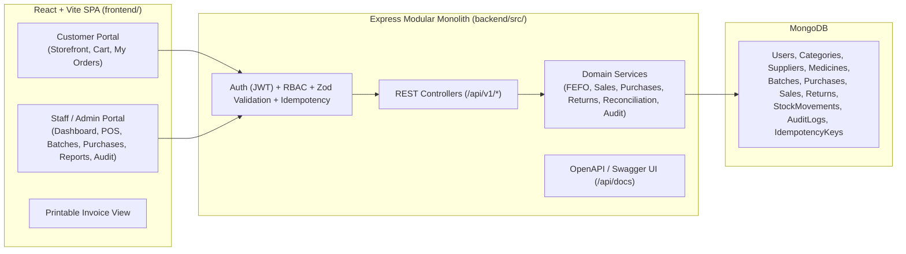
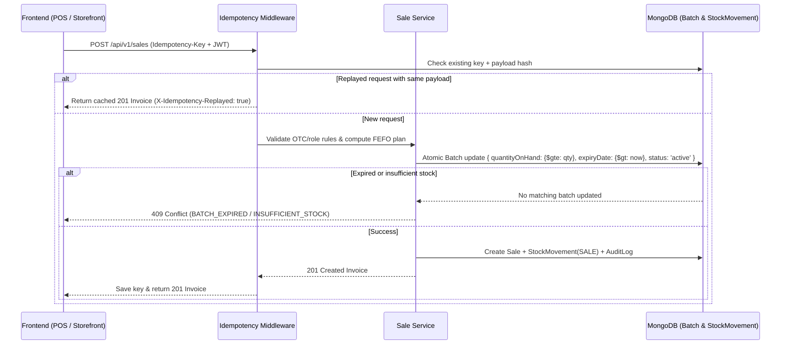

# System Architecture

Medilo follows a **3-tier Modular Monolith** architecture using the **MERN** stack (MongoDB, Express, React, Node.js), separating UI presentation, HTTP transport/validation, domain business logic, and persistence.

## Critical Transaction & Concurrency Flow (Sale Checkout)

