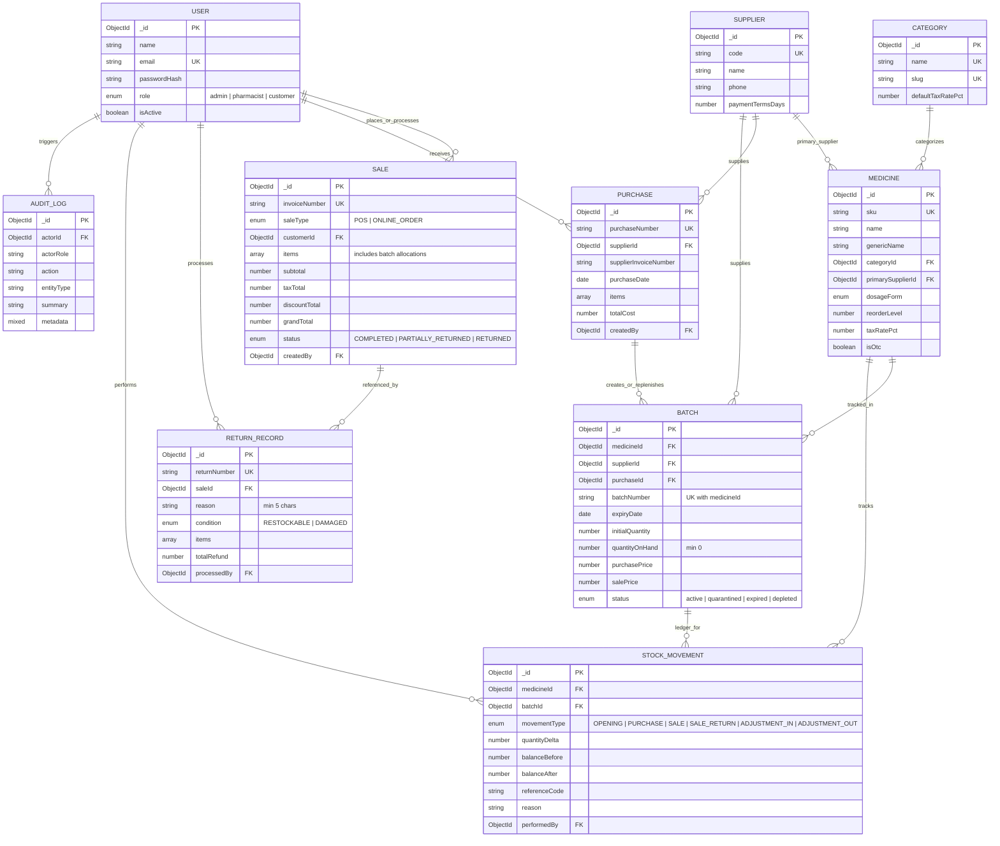

# Database Schema & Entity-Relationship Diagram

Medilo uses MongoDB with Mongoose schemas, strict validation rules, compound unique constraints, and operational indexes.

## Entity-Relationship Diagram

## Key Constraints & Indexes

- **`Batch`**:
  - Compound unique index `{ medicineId: 1, batchNumber: 1 }` prevents duplicate batch records for the same medicine.
  - Compound FEFO lookup index `{ medicineId: 1, status: 1, expiryDate: 1, quantityOnHand: 1 }`.
  - Schema constraint `quantityOnHand: { min: 0 }` plus atomic `$gte` filter on deductions guarantees stock never silently becomes negative.
- **`IdempotencyKey`**:
  - Unique compound index `{ key: 1, userId: 1, route: 1 }` with 24-hour TTL (`expires: 86400`).
- **`StockMovement`**:
  - Indexed on `{ medicineId: 1, createdAt: 1 }` and `{ createdAt: -1 }` for fast reconciliation and audit queries.
